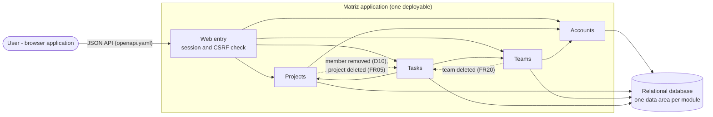

# Matriz — Architecture

This is the entry point of the Architecture Pack of the Matriz MVP. It summarises the chosen architecture and why it was chosen. The details are in the documents linked from each section.

## 1. Decision

Matriz is a **modular monolith** ([ADR-0001](architecture/adr/ADR-0001-modular-monolith.md)):
- **One application and one database:** a single application, deployed as one unit, with one relational database.
- **Four business modules:** Accounts, Projects, Teams and Tasks. Each module owns its own data and exposes a small public interface to the others. Tasks also owns the comments and the task counts of the home dashboard.
- **Simple layers inside each module:** presentation, business logic and data access.
- **One-way dependencies:** Projects and Teams depend on Accounts, and Tasks depends on Projects and Teams. When Projects removes a member or deletes a project, or Teams deletes a team, Tasks reacts to an in-process event, in the same transaction (D10, FR05, FR20).
- **Sessions:** server-side sessions identified by a session cookie, stored in the shared database, with a CSRF token on every data-changing request ([ADR-0002](architecture/adr/ADR-0002-session-cookie-authentication.md)).

## 2. Justification

**Why this architecture suits the MVP** (ADR-0001). The context is one developer, about 3 weeks, about 50 users and a local demonstration (constraints.md, ASM07–ASM10).

| Alternative | Decision | Reason |
|---|---|---|
| **Monolith (layers only)** | Rejected | Same effort to run and demonstrate as the chosen option, but the business areas aren't visible in the code, and changes in one area can break another. |
| **Modular monolith, simple layers** | **Chosen** | The same single application and database as the monolith, so the demo is just as simple. Business boundaries are visible and easy to defend. Changes stay contained. A module can later be extracted if it ever needs to scale on its own. |
| **Modular monolith with Onion/Clean inside each module** | Rejected | An estimated 30–50% more code and time for an application that is mostly CRUD with few rules. It adds no scalability. |
| **Microservices** | Rejected | Several services, databases and network calls, and a riskier demo, with no requirement that needs them. The rules that cross areas (NFR03, D09, D10) would lose their shared transaction. |

**Why server-side sessions with a cookie** (ADR-0002):
- **Log-out:** it is immediate (US02 AC02).
- **Security:** the cookie can't be read by page scripts.
- **No extra infrastructure:** sessions are stored in the shared database.
- **Effort:** it is the lowest-effort option for the context.

The full comparison is in [03-alternatives.md](architecture/03-alternatives.md).

## 3. Contents of the Architecture Pack

| Document | Contents |
|---|---|
| [architecture/02-domain-model.md](architecture/02-domain-model.md) | Domain model at two levels: business areas and conceptual model, with the invariants and the task life cycle. |
| [architecture/03-alternatives.md](architecture/03-alternatives.md) | Monolith, modular monolith and microservices compared for the MVP. |
| [architecture/04-solution-architecture.md](architecture/04-solution-architecture.md) | Containers, modules and their responsibilities, dependency rules, key sequences (US05, US09, US13), quality attributes, deployment view, risks and open points. |
| [architecture/adr/](architecture/adr/) | Architecture decision records: ADR-0001 (modular monolith) and ADR-0002 (session cookie authentication). |
| [database.md](database.md) | Logical data model and ER diagram. |
| [../openapi.yaml](../openapi.yaml) and [api-contract.md](api-contract.md) | API specification (30 operations) and the reasoning behind it. |
| [ui/](ui/README.md) | Low-fidelity wireframe of the home dashboard, the project board and the task details. |

## 4. Assumptions and pending decisions

- **Assumptions:** the context assumptions behind the architecture (ASM07–ASM11) are in [constraints.md, section 2](constraints.md#2-assumptions). Assumptions specific to one artefact are recorded where they apply:
  - the data model (A1–A5);
  - the API contract (AS01–AS15).
- **Pending decisions:** listed in [constraints.md, section 4](constraints.md#4-pending-decisions). The ones that affect the architecture most are:
  - the technology stack (PD01);
  - session expiry (PD02);
  - the tool for checking module boundaries (PD03);
  - how references between modules' data are protected (PD04);
  - concurrent assignment and removal (PD05).

## 5. Technology stack

**Status: Confirmed by the user on 2026-11-11 (PD01).** No stack was recorded in Lab 02, so a simple one was proposed, following the user's instruction to select one when the decision is pending. The user then asked for a server database, because the application will be deployed, and for a React single-page application.

| Part | Proposal | Why |
|---|---|---|
| **Language** | Java 21 (LTS) | The developer's experience (ASM07). |
| **Application framework** | Spring Boot 3, one application (ADR-0001): Spring Web for the JSON API in `openapi.yaml`, Spring Security for the session cookie and the CSRF header (ADR-0002), Spring Session JDBC to keep sessions in the shared database (ADR-0002), Spring Data JPA for data access. | Covers ADR-0001 and ADR-0002 with standard, well-known parts; the developer already knows them (ASM07). |
| **Database** | PostgreSQL, one database for the whole application (ADR-0001), the same product in development, tests and deployment. Schema managed with Flyway migrations, one folder per module. Locally it runs in a container (Docker Compose); the tests use Testcontainers. | The application will be deployed, so the database must be a server database that keeps its data between restarts and runs the same way everywhere. PostgreSQL is free, widely hosted and well supported by Spring Boot and Flyway. |
| **Browser application** | A single-page application in React with TypeScript, built with Vite. The build output is copied into the Spring Boot JAR (e.g. with the `frontend-maven-plugin`) and served by the same application. In development, the Vite server forwards `/api` to Spring Boot. | It is the client the API was designed for (AS01 in api-contract.md). Served from the same site as the API, which `SameSite=Lax` needs (ADR-0002, ASM11), and still one deployable (ADR-0001). React has ready-made parts for the board's drag and drop (US07) and for forms; TypeScript keeps the client's types in line with `openapi.yaml`. |
| **Build and tests** | Maven (with the wrapper) builds the whole application, including the browser application. JUnit 5 and Spring Boot Test with MockMvc for the API, one test per acceptance criterion where possible, against PostgreSQL in Testcontainers. Vitest and Testing Library for the browser application's components. | Standard for each part; tests map to the acceptance criteria (C08), on the same database as the deployment. |
| **Packaging** | One executable JAR, in one container image, so the same artefact runs locally and in the deployment (ADR-0001: one deployable). | Simple to deploy on most hosting platforms. |

**Alternatives considered:**
- **H2 (embedded, file mode) instead of PostgreSQL:** nothing to install, but it isn't meant for a deployed application: data lives in a file on the application's machine, which many hosting platforms erase on restart, and its SQL differs from a server database. Rejected once a deployment was confirmed.
- **MySQL or MariaDB instead of PostgreSQL:** equally valid; PostgreSQL is proposed for its wider support on free hosting tiers and its case-insensitive and partial indexes (useful for unique team names, D06).
- **Plain JavaScript instead of React:** no build step, but the board, filters, comments and assignees would end up re-creating parts of a framework. Proposed first, then replaced at the user's request.
- **Vue or Angular instead of React:** Vue is equally suitable and simpler to learn, with a smaller ecosystem; Angular is heavy for 23 stories and one developer.
- **Server-rendered pages (e.g. Thymeleaf with htmx):** no second toolchain, but the client would no longer use the JSON API in `openapi.yaml` (AS01), so the contract would have to be revised.

**Deployment.** The user confirmed that the application will be deployed. Where it is deployed, and the deployment plan, are left for later (PD13). Whatever the platform, the deployment must:
- serve the application over HTTPS, because the session cookie is `Secure` (SEC08, ADR-0002);
- serve the browser application and the API from the same site (ADR-0002);
- give the database connection details and the demo account passwords through environment variables or the platform's secret store, never in the repository (SEC10, AGENTS.md §7).

**Not decided here:** these stay pending, with options in [implementation-plan.md, section 1.3](implementation-plan.md#13-pending-technical-decisions):
- the module-boundary check (PD03);
- foreign keys between modules (PD04);
- the concurrency rule (PD05);
- the password hashing method (PD06);
- the demo account seed (PD12);
- the deployment platform (PD13).

**Follow-ups, proposed:** close PD01 in [constraints.md](constraints.md), and add the build, test and style commands to AGENTS.md §10 once the project is created ([implementation-plan.md](implementation-plan.md), increment I0).
