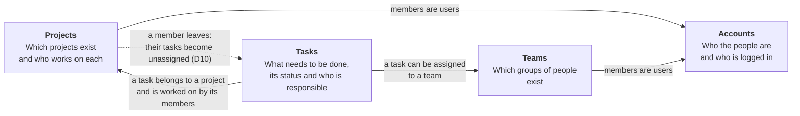
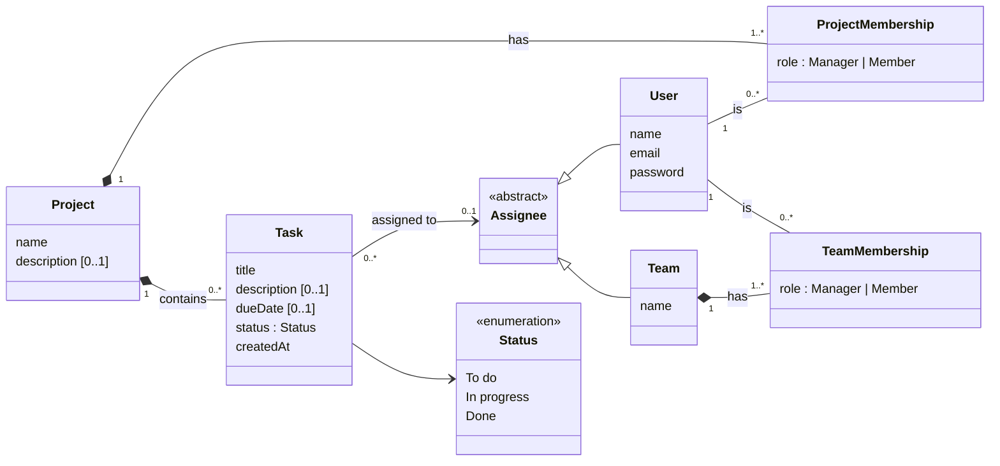
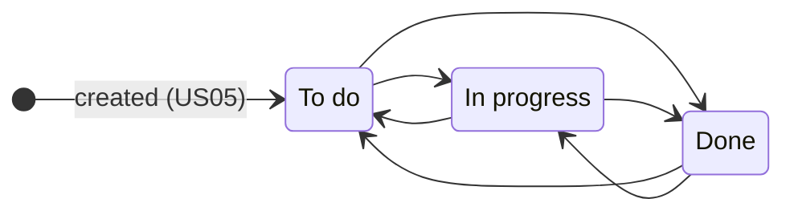

# Matriz — Domain model (MVP)

This document explains the Matriz business in its MVP version, at two levels of detail:

- **Level 1 — Business areas:** the four areas of the business, what each one is about and how they depend on each other. Readable without any technical background.
- **Level 2 — Conceptual model:** the business concepts, their attributes, relationships, multiplicities and rules, plus the life cycle of a task.

Both levels are conceptual: they describe the business, not how it is stored. The logical data model (tables, keys, types) is in [database.md](../database.md). Sources: [requirements.md](../requirements.md) (MVP scope), the [user stories](../user-stories.md) and their decisions D01–D12, and [ADR-0001](adr/ADR-0001-modular-monolith.md).

## Glossary

The terms used in the requirements, the user stories, this model and the code.

| Term | Meaning |
|---|---|
| **User** | A person with an account in Matriz. |
| **Project** | A piece of work that groups tasks and the people working on them. |
| **Project member** | A user who belongs to a project and can work on its tasks. |
| **Project manager** | The user who created a project. Manages its members. Always a member too. |
| **Team** | A named group of users that can be assigned tasks as a whole. Exists independently of projects. |
| **Team manager** | The user who created a team. Manages its members. Always a member too. |
| **Task** | A unit of work inside one project. |
| **Status** | Where a task stands: To do, In progress or Done. |
| **Assignee** | Who is responsible for a task: one person or one team. A task can also be unassigned. |
| **Due date** | Optional date by which a task should be done. |

## Level 1 — Business areas

### The business in one paragraph

People create an account and organise their work in **projects**. Whoever creates a project manages it and decides who its **members** are. Members record the work to be done as **tasks**, follow each task through its **status**, and make clear who is responsible for it by **assigning** it to a member or to a **team**. Teams are groups of people that exist outside any single project, so the same team can take on tasks in several projects.

### Business areas and their relationships

An arrow means "depends on": the area at the start of the arrow uses information from the area at the end. The dashed arrow is a business event: when a member leaves a project, the Tasks area reacts to it.

| Area | What it is about | Key questions it answers | User stories |
|---|---|---|---|
| **Accounts** | People and their access to Matriz. | Who is this person? Are they logged in? | US01, US02 |
| **Projects** | Projects and who works on them. | Which projects is this person in? Is this person a member of this project? Who manages it? | US03, US04, US09 |
| **Teams** | Groups of people. | Which teams exist? Who is in each team? | US11, US12 |
| **Tasks** | The work itself. | What has to be done in this project? In what state is it? Who is responsible? | US05–US08, US10, US13 |

These areas are the four modules of the architecture (ADR-0001), so the business structure and the code structure match.

## Level 2 — Conceptual model

### Concepts and relationships

**How to read it:**
- **Memberships:** a **ProjectMembership** links one user to one project, with a role. A **TeamMembership** does the same for teams.
- **Composition (filled diamond):** tasks and memberships only exist inside their project or team.
- **Assignee:** an abstract concept, which is either a **User** or a **Team**. Each task has zero or one assignee.

The role appears here as a business concept. In the logical data model it is derived from the project's or team's manager (database.md, A3).

### Business rules (invariants)

These rules must hold at all times. Each one is protected by the area that owns the concept.

| # | Rule | Area | Source |
|---|---|---|---|
| I01 | An email identifies at most one user, ignoring case. | Accounts | FR01, D03 |
| I02 | A user's password is never kept or shown in readable form. | Accounts | NFR04 |
| I03 | A project has exactly one manager, who is its creator and also a member. The manager never changes and can't be removed. | Projects | FR03, D07 |
| I04 | A user is a member of a project at most once. | Projects | US09 AC05 |
| I05 | Only members can see or change a project and its tasks. Only the manager can change who the members are. | Projects | NFR03, FR06 |
| I06 | A team has a unique name, ignoring case. | Teams | D06 |
| I07 | A team has exactly one manager, who is its creator and also a member. The manager never changes and can't be removed. | Teams | FR08, D07 |
| I08 | A task belongs to exactly one project, for its whole life. | Tasks | FR10 |
| I09 | A task has exactly one status, and starts as To do. | Tasks | FR10, FR13 |
| I10 | A task has at most one assignee: one person or one team. | Tasks | FR14 |
| I11 | A person can only be assigned a task if they are a member of the task's project at that moment. | Tasks | US10 AC04 |
| I12 | A team can only be assigned a task if all its members are members of the task's project at that moment. Later changes to the team don't undo the assignment. | Tasks | D09 |
| I13 | When a person stops being a member of a project, they stop being the assignee of that project's tasks. Assignments to teams are kept. | Tasks | D10 |
| I14 | A due date, when set or changed, is not earlier than the current day. | Tasks | D12 |
| I15 | Only the project manager can edit or delete a project, and only the team manager can rename or delete a team. Deleting a project deletes its tasks and memberships. Deleting a team unassigns its tasks. Deleting anything needs the user's confirmation. | Projects, Teams, Tasks | FR04, FR05, FR12, FR19, FR20, NFR05 |

### Life cycle of a task

Any member can move a task between any two statuses, including backwards (US07, D08). Statuses are fixed and can't be configured (C04). A task can be deleted by any member, after confirming (US16, NFR05). Deleting a project deletes all its tasks (US15).

Independently of its status, a task's assignee changes like this:

| From | Event | To | Source |
|---|---|---|---|
| Unassigned | Assigned to a member or a team | Assigned | US10, US13 |
| Assigned | Assigned to someone else | Assigned (new assignee replaces the old one) | US10 AC02, US13 AC02–AC03 |
| Assigned | Assignment undone | Unassigned | US10 AC03 |
| Assigned to a person | That person leaves the project | Unassigned | D10, US09 AC03 |

### Business events

| Event | Raised by | What happens | Source |
|---|---|---|---|
| **Member removed from project** | Projects | Tasks unassigns that person's tasks in the project, in the same transaction. | D10, ADR-0001 |
| **Project deleted** | Projects | Tasks deletes all the project's tasks, in the same transaction. | FR05, US15 |
| **Team deleted** | Teams | Tasks unassigns every task assigned to the team, in the same transaction. | FR20, US18 |

These are the only events between areas in the MVP.

## What is not in the MVP domain

These concepts are deliberately absent, so they aren't modelled:

- **Comments, subtasks, attachments, change history, notifications:** future features F01–F07.
- **Sprints, reports, external integrations, configurable statuses or fields:** excluded by constraints C01–C04.
- **Administrator role:** not part of the MVP (constraints.md, ASM01).
- **Login session:** part of how access works, not a business concept. It appears only in the data model.
