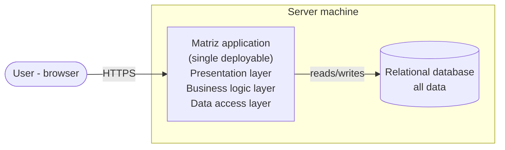
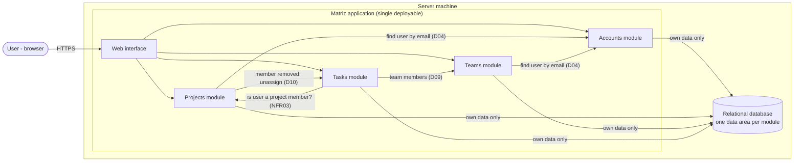
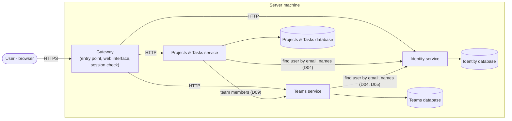

# Matriz — Architecture alternatives (MVP)

This document compares three alternatives for the Matriz MVP: **A. Monolith**, **B. Modular monolith** and **C. Microservices**. The three alternatives were fixed by the user. The document doesn't recommend any of them: the choice belongs to the user.

All three alternatives can satisfy every MVP requirement (FR01–FR03, FR06–FR11, FR13–FR15, NFR02–NFR04, NFR07) and every constraint (C01–C08). They differ in how the code is structured and how it is deployed.

## 1. Context and assumptions

**Context given by the user**

- One developer, experienced in Java and Spring Boot.
- The application runs locally; for the assessment it is demonstrated on a server, which can be the developer's own machine.
- Around 50 users, equivalent to 2 or 3 pilot teams.
- Academic project; no architectural style is required.
- Timeline: 3 weeks for the MVP, about 15 working days for the 13 user stories, one developer (about one story per day, including tests).

**Assumptions** (correct them if they are wrong)

| # | Assumption | Impact if wrong |
|---|---|---|
| AS01 | The only client is a **browser-based** interface. No mobile or desktop client in the MVP. | Other clients would require a public API separate from the screens. All three alternatives can add one; the effort is similar. |
| AS02 | Data is kept in a **relational database**, because the domain is made of related entities (users, projects, memberships, teams, tasks) and the rules need consistent updates (D10, US09 AC03). | A different storage category wouldn't change the comparison between A, B and C. |
| AS03 | **Sessions are managed by the application** with email and password only. No external identity provider (C03). | None: C03 excludes third-party login. |
| AS04 | The demonstration runs on **one machine**, with no high-availability or scaling requirement. 50 users don't need more. | If the demo had to run on several machines or survive failures, C would gain relevance and A/B would need replication. |
| AS05 | How the browser interface is built (pages rendered by the server or a separate browser application calling an API) is **orthogonal** to this choice and is left to the stack phase. The diagrams show it as a single "Web interface" part. | None for this comparison. |

**Rules that cross feature areas.** These are the rules that most separate the alternatives, because they need data from more than one area in the same operation:

- **NFR03 / DoD03:** every task operation must first check that the user is a member of the task's project.
- **D10 / US09 AC03:** removing a project member must unassign that person's tasks in the project, in the same operation.
- **D09 / US13 AC04:** assigning a task to a team must check that all team members belong to the project.
- **D04 / D05:** adding people by email and listing team members by name needs account data.
- **NFR07 / D11:** a saved change is visible on the next read; the last saved change wins.

## 2. Alternative A — Monolith

### Summary

One application, deployed as a single unit, with one database. The code is organised by **technical layer** (presentation, business logic, data access), and any part of the business logic can use any data directly.

### Container diagram

### How it handles the cross-area rules

All rules run inside one process and one database transaction. D10 (unassign tasks when removing a member), D09 (team members must belong to the project) and the NFR03 membership check are plain queries and updates on the same database. NFR07 and D11 follow from all writes going to one database with no copies.

### Strengths for the MVP

- The least code and configuration of the three: one project, one build, one database.
- Simplest to run and demonstrate: start the database and one application.
- Cross-area rules (D09, D10, NFR03) are simple and fully consistent.
- Easy to debug: one process, one log.

### Weaknesses and risks for the MVP

- Nothing in the structure stops one feature area from depending on the internals of another. As features grow, changes in one area (e.g. teams) can break another (e.g. tasks).
- Boundaries between accounts, projects, teams and tasks are not visible in the code, so the architecture is harder to explain in an academic report beyond "layered".
- Low risk at MVP size; the risk grows with the Should and future features.

### Effort and complexity: **low**

One deployable and one database; no inter-component communication to design.

### Evolution towards the Should requirements

All Should requirements are local changes: FR04, FR05 (delete a project and its tasks in one transaction), FR12, FR17 (filter query), FR18 (copy team members into the project), FR16 (one query joining tasks, teams and memberships), NFR05 (confirmation in the interface) and NFR06 (indexes on the task list). The main cost is keeping the code tidy as it grows.

## 3. Alternative B — Modular monolith

### Summary

One application, deployed as a single unit, with one database, but the code is split into **business modules** with explicit boundaries: Accounts, Projects, Teams and Tasks. Each module owns its data and exposes a small public interface; other modules can only use that interface, never its internals or its tables.

### Container diagram

### Module responsibilities

| Module | Responsibility | Traces to |
|---|---|---|
| Accounts | Sign-up, log-in/out, sessions, password protection, user lookup by email | FR01, FR02, NFR02, NFR04, D03, D04 |
| Projects | Projects, memberships, manager role, membership checks for other modules | FR03, FR06, FR07, NFR03, D07 |
| Teams | Teams, team members, unique team names, team list visible to all | FR08, FR09, D05, D06, D07 |
| Tasks | Tasks, statuses, assignment to a person or team | FR10, FR11, FR13, FR14, FR15, D08, D11, D12 |

### How it handles the cross-area rules

Modules call each other's public interfaces **in the same process**, so a single database transaction can still cover a rule that crosses modules. D10: when Projects removes a member, it calls Tasks to unassign that person's tasks in the same transaction. D09: Tasks asks Teams for the team's members and Projects whether they are all members. NFR07 and D11 behave as in A.

### Strengths for the MVP

- Same deployment and demonstration simplicity as A: one application and one database.
- Cross-area rules stay fully consistent, as in A.
- Clear boundaries that mirror the domain (accounts, projects, teams, tasks), which are easy to explain and defend in an academic context.
- Changes stay contained in one module, which reduces the risk of breaking other areas as the Should features arrive.

### Weaknesses and risks for the MVP

- More up-front design than A: the developer must define each module's public interface and respect it. Without an automated check, boundaries erode over time.
- Some extra code to cross boundaries (e.g. the task list must ask Accounts and Teams for names instead of reading their data directly), which can feel like overhead in a small application.
- Dividing the code into modules too early can produce boundaries that later prove wrong; at MVP size they are cheap to adjust.

### Effort and complexity: **low to medium**

Same runtime as A; the extra effort is in designing and keeping the module boundaries.

### Evolution towards the Should requirements

Most Should requirements stay inside one module: FR04, FR05 (Projects asks Tasks to delete the project's tasks, same transaction), FR12, FR17 (Tasks), NFR05 (interface). FR18 is Projects calling Teams for the member list. FR16 needs Tasks to ask Teams which teams the user belongs to. NFR06 may need the task list to fetch names in one batch instead of one call per task. The modules could later be extracted into separate services if ever needed, though nothing in the requirements asks for it.

## 4. Alternative C — Microservices

### Summary

The application is split into **independently deployed services**, each with its own database, communicating over the network. To limit cross-service rules, services follow the boundaries where rules are tightly coupled: Identity, Projects & Tasks, and Teams. A gateway is the single entry point for the browser.

Tasks are kept with Projects on purpose: NFR03 (every task operation checks project membership) and D10 (removing a member unassigns tasks) would otherwise become network calls with no shared transaction.

### Container diagram

### Service responsibilities

| Service | Responsibility | Traces to |
|---|---|---|
| Gateway | Single entry point; serves or routes the web interface; rejects requests without a valid session | NFR02, DoD02 |
| Identity | Accounts, log-in/out, sessions or tokens, password protection, user lookup | FR01, FR02, NFR04, D03, D04 |
| Projects & Tasks | Projects, memberships, tasks, statuses, assignments, membership checks | FR03, FR06, FR07, FR10, FR11, FR13–FR15, NFR03, D07, D08, D10–D12 |
| Teams | Teams, team members, unique team names | FR08, FR09, D05, D06, D07 |

### How it handles the cross-area rules

- **NFR02:** the gateway checks the session on every request, and each service must trust or re-check the identity it receives.
- **NFR03 and D10:** local to Projects & Tasks, one transaction.
- **D09:** at assignment time, Projects & Tasks calls Teams for the current member list. Because D09 only checks at the moment of assignment, a synchronous call is enough. If Teams is down, team assignment fails.
- **D04/D05:** adding by email and showing names need calls to Identity, or a local copy of user names kept in sync.
- **NFR07 / D11:** satisfied within each service, since each piece of data has one owner.

### Strengths for the MVP

- Each service can be built, deployed and scaled independently.
- Demonstrates distributed-system concepts (service boundaries, gateway, network communication), which may be valued in an academic report.
- A failure in one service (e.g. Teams) leaves the others partly usable.

### Weaknesses and risks for the MVP

- The highest effort for one developer: several projects, builds, databases and configurations, plus the communication between them.
- Network calls replace in-process calls: handling of timeouts, unavailable services and partial failures is needed even at 50 users.
- Authentication spans services (NFR02), which is more work and more risk than in A or B.
- Running the demo requires starting and connecting several processes and databases, usually with a container platform; more things can fail during the demonstration.
- None of the MVP requirements (50 users, one machine, AS04) needs independent scaling or deployment, so most of the benefits are not used.

### Effort and complexity: **high**

Four deployables, three databases, inter-service communication, distributed authentication and multi-process local setup.

### Evolution towards the Should requirements

FR04, FR05, FR12, FR17 and NFR05 are local to one service. FR18 is a call from Projects & Tasks to Teams. FR16 needs the user's teams from Teams, then a query in Projects & Tasks. NFR06 (500 tasks in under 2 s) requires care: the task list needs user and team names from two other services, so it needs batch calls or local copies of names. If tasks were later split into their own service, D10 and NFR03 would become cross-service and need events or compensation.

## 5. Comparison

| Criterion | A. Monolith | B. Modular monolith | C. Microservices |
|---|---|---|---|
| **Development effort for a single developer** | Low. One codebase, no boundaries to design, cross-area rules are direct queries. | Low to medium. One codebase, plus the effort of defining and respecting module interfaces. | High. Several codebases, network communication, failure handling and distributed authentication for one person in a few weeks. |
| **Ease of running and demonstrating on a local server** | High. Start one database and one application. | High. Same as A: one database and one application. | Low to medium. Several services and databases must be started and connected; usually needs a container platform; more points of failure during the demo. |
| **Operational complexity** | Low. One process, one database, one log, one backup. | Low. Same as A. | High. Several processes and databases, cross-service configuration, logs spread across services, partial failures to monitor. |
| **Ease of evolving towards the Should requirements** | High in the short term: every Should requirement is a local change. Risk of coupling grows as features accumulate. | High: most Should requirements stay inside one module; boundaries keep changes contained. | Medium: FR16 and FR18 need cross-service calls; NFR06 needs care because the task list combines data from three services. |

No overall score is given. Under a specific condition one option fits better: if the priority is the shortest path to a working demo, A and B have the lowest effort and setup; if demonstrating distributed-system concepts is itself a goal of the work, C is the only one that does so; if visible, enforced domain boundaries matter for maintenance or for the report without adding runtime complexity, B is the one that provides them.

## 6. Questions to help you decide

1. Do you want the report to show the domain boundaries (accounts, projects, teams, tasks) explicitly in the code, or is a conventional layered structure enough?
2. Is demonstrating distributed-system concepts (independent services, network communication, a gateway) a learning goal of this project, or only a cost?
3. How much setup risk can you accept on assessment day: one application and one database, or several services and databases that must all start correctly?
4. Do you expect to keep developing Matriz after the MVP (Should and future features), so that containing changes per module becomes important?
5. Will the project ever need parts to be deployed or scaled independently, given the expected 50 users?
