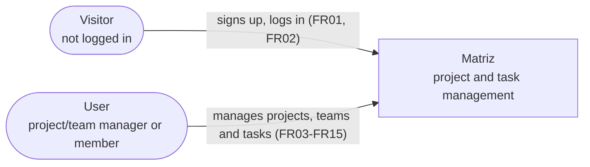
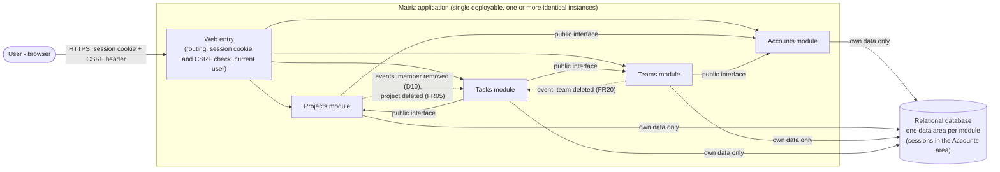
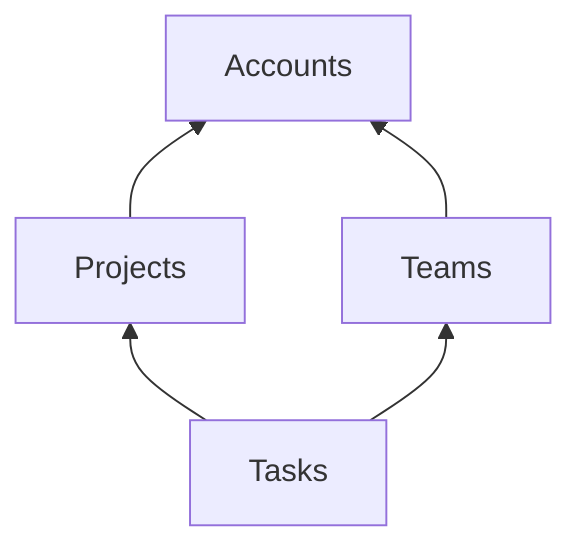
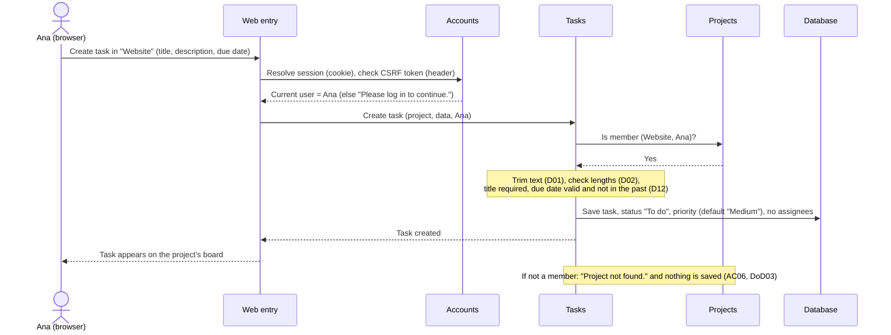
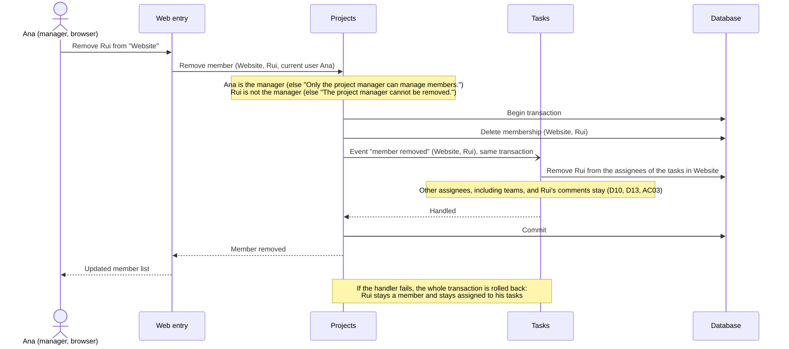
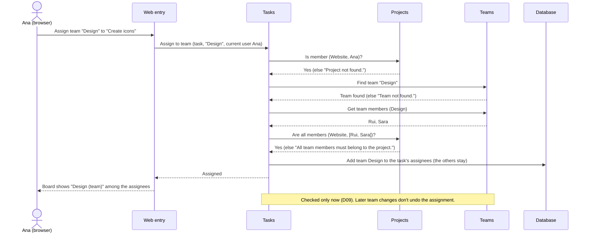
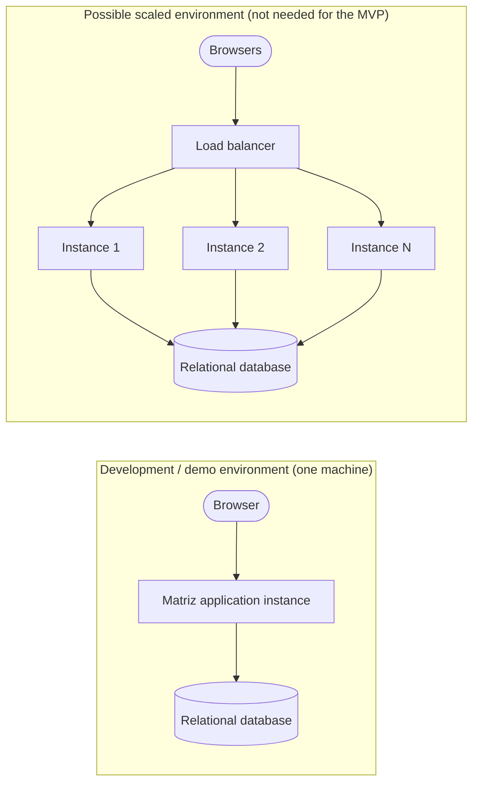

# Matriz — Solution architecture (MVP)

This document details the architecture chosen in [ADR-0001](adr/ADR-0001-modular-monolith.md): a **modular monolith** with four business modules and **simple layers inside each module**. Authentication uses server-side sessions identified by a session cookie and stored in the shared database ([ADR-0002](adr/ADR-0002-session-cookie-authentication.md)). The alternatives that were compared are in [03-alternatives.md](03-alternatives.md).

It stays technology-independent: languages, frameworks, libraries and products are chosen in the stack phase.

## 1. Context

Matriz has no external systems: no email, calendar, chat or third-party login (C03). Everything a user does happens through a web browser (assumption AS01 in 03-alternatives.md).

The actors come from section 2 of the requirements: the project manager, project member and team manager are all Users with a role in a specific project or team.

## 2. Containers

| Container | Responsibility | Traces to |
|---|---|---|
| **Browser** | Runs the client application: a browser application served by the Matriz application from the same site (ADR-0002), which calls the API described in `openapi.yaml`. Shows the interface and the exact English messages returned by the API. Holds no business rules. Keeps the session cookie (`HttpOnly`, so page scripts can't read it) and sends the CSRF token in a request header on every data-changing operation. | AS01, C05, ADR-0002 |
| **Matriz application** | All business logic, the web interface and access control. Deployed as one unit; several identical instances may run at the same time (section 6). | ADR-0001 |
| **Relational database** | Stores all data. Each module owns its own data area. Sessions are stored here, in the Accounts data area, never in an instance's memory. | AS02, NFR07, ADR-0001, ADR-0002 |

The browser application calling a JSON API settles assumption AS05 of [03-alternatives.md](03-alternatives.md) (see AS01 in `docs/api-contract.md`).

## 3. Components of the application

### 3.1 Module structure

Every module has the same internal structure, in **simple layers** (ADR-0001):

| Layer | Responsibility |
|---|---|
| **Presentation** | Exposes the module's API operations (`openapi.yaml`). Receives the requests, returns the data and the exact English messages (C05, DoD01, DoD04) in Problem Details errors. Calls only its own business logic. |
| **Business logic** | Applies the module's rules and validations (D01, D02, D03, D12 where relevant), checks permissions, controls the transaction. Calls its own data access and the **public interface** of the modules it depends on. |
| **Data access** | Reads and writes only the module's own data. |

Each module exposes a **public interface** (a small set of operations other modules may call) and keeps everything else **internal**. The public interface is part of the business logic layer.

### 3.2 Dependency rules

1. Arrows point from the module that uses to the module that is used. Allowed: **Projects → Accounts**, **Teams → Accounts**, **Tasks → Projects**, **Tasks → Teams**. No other direct dependency is allowed, and there are no cycles.
2. A module may only call another module's **public interface**, never its internal parts.
3. A module may only read and write **its own data**. It refers to another module's entities only by their identifier (e.g. Tasks stores the assignee's user or team identifier).
4. When a module higher up must react to something in a lower module, it does so through an **in-process internal event**, handled synchronously in the same transaction. In the MVP there are three: **"member removed"** (D10), **"project deleted"** (FR05) and **"team deleted"** (FR20).
5. The rules are checked automatically as part of the build. The tool is chosen in the stack phase (open point 3).

### 3.3 Web entry (shared, not a business module)

| Responsibility | Traces to |
|---|---|
| Routes each request to the right module's presentation layer. | — |
| Before any protected request, asks Accounts to resolve the session from the session cookie. If there is no valid session, refuses the request with "Please log in to continue." and asks the user to log in. | NFR02, DoD02, US02 AC06, ADR-0002 |
| On every operation that changes data while logged in, asks Accounts to check the CSRF token sent in the request header, and refuses the request if it doesn't match the session. Log-in is exempt, because no session exists yet. | NFR02, ADR-0002 |
| Passes the **current user's identifier** to the module, so modules don't need to handle sessions. | NFR02 |

### 3.4 Modules

#### Accounts

| | |
|---|---|
| **Responsibility** | Log-in and log-out, the current user, sessions, password protection, user lookup. Its users are the demo accounts created by the seed (FR21, PD12); sign-up is an optional extension (FR01). |
| **Owns** | Users (name, email, protected password), sessions (stored in the shared database, ADR-0002). |
| **Rules** | Unique email, compared case-insensitively (FR01, D03). Passwords never stored or shown in readable text (NFR04). Same message for wrong password and unknown email (US02 AC09). Sessions are server-side, identified by an unguessable identifier in a session cookie (`HttpOnly`, `Secure`, `SameSite=Lax`), and stored in the shared database, never in an instance's memory (ADR-0001, ADR-0002). Log-in creates the session and issues its CSRF token. The current session returns the logged-in user (US02 AC10). Demo account passwords come from configuration outside the repository (SEC10). Log-out deletes the session, so the cookie stops working immediately (US02 AC02, ADR-0002). A session ends after 30 minutes without requests (PD02; section 7, open point 2). |
| **Public interface** | *Resolve session* (session cookie → current user or none). *Check CSRF token* (session, token → valid or not). *Find user by email* (email → user identifier, name, email, or "not found"). *Get users* (list of identifiers → names and emails). |
| **Depends on** | Nothing. |
| **User stories** | US19, US02 (US01 as an optional extension) |

#### Projects

| | |
|---|---|
| **Responsibility** | Projects, project memberships, the manager role and the search of the user's projects by name. Answers "is this user a member of this project?" for the rest of the application. |
| **Owns** | Projects (name, description, manager), memberships (project, user, role). |
| **Rules** | The creator becomes manager and member (FR03, D07). Only the manager manages members (FR06, NFR03, US09 AC07). The manager can't be removed (D07, US09 AC06). Members are added by email (D04). Only the manager edits or deletes the project (FR04, FR05, NFR03). Deleting a project deletes its memberships and publishes *project deleted* (FR05). Non-members get "Project not found." (DoD03). |
| **Public interface** | *Is member* (project, user → yes/no). *Get members* (project → identifiers, names, emails, roles). *Are all members* (project, list of users → yes/no). *Get my projects* (user, optional name text → projects with the user's role, sorted by name). *Get user names* (list of user identifiers → names, through Accounts; used for the authors of comments who have left the project, D13). |
| **Publishes** | *Member removed* (project, user), inside the transaction that removes the membership. *Project deleted* (project), inside the transaction that deletes the project. |
| **Depends on** | Accounts (find user by email, get names). |
| **User stories** | US03, US04 (list and role), US09, US14, US15, US23 |

#### Teams

| | |
|---|---|
| **Responsibility** | Teams, team members and the team manager role. |
| **Owns** | Teams (unique name, manager), team memberships. |
| **Rules** | Team names are unique (D06). The creator becomes manager and member (FR08, D07). Only the manager manages members (FR09, US12 AC06). The manager can't be removed (D07). Members are added by email (D04). Every user sees every team and its members (D05). Only the manager renames or deletes the team (FR19, FR20). Deleting a team deletes its memberships and publishes *team deleted* (FR20). |
| **Public interface** | *Find team* (name or identifier → team, or "not found"). *Get team members* (team → user identifiers). *Get team names* (list of identifiers → names). |
| **Publishes** | *Team deleted* (team), inside the transaction that deletes the team. |
| **Depends on** | Accounts (find user by email, get names for the team list). |
| **User stories** | US11, US12, US17, US18 |

#### Tasks

| | |
|---|---|
| **Responsibility** | Tasks of a project: creation, details, editing, deletion, status, priority, assignees, comments, the board with its filters, and the task counts of the home dashboard. |
| **Owns** | Tasks (project, title, description, due date, status, priority), their assignees (user identifiers and team identifiers, zero or more of each) and their comments (author identifier, text, dates). |
| **Rules** | Every operation checks that the current user is a project member (NFR03, DoD03). Title, description and due date validation (US05, US08, D01, D02, D12). Fixed statuses "To do", "In progress", "Done", any transition (FR13, C04). Fixed priorities "Low", "Medium", "High", "Medium" by default (FR10, C04). Zero or more assignees, people and teams, each at most once (ASM04 in constraints.md). A person assignee must be a project member (US10 AC04, AC05). A team assignee's members must all be project members, checked only when assigning (D09, US13 AC04). Any member can change any task (D08). Last saved change wins (D11). Comment text 1–2000 characters; only the author edits or deletes a comment (FR23, NFR03). Filters by status and priority (FR17). |
| **Public interface** | None used by other modules in the MVP. |
| **Handles** | *Member removed* (project, user): removes that person from the assignees of the project's tasks; other assignees, including teams, and their comments stay (D10, D13, US09 AC03, US13 AC08). *Project deleted* (project): deletes all the project's tasks with their assignees and comments (FR05, US15 AC02). *Team deleted* (team): removes the team from the assignees of every task (FR20, US18 AC02). |
| **Depends on** | Projects (is member, get members with names, are all members, get my projects, get user names), Teams (find team, get team members, get team names). |
| **User stories** | US04 (task counts), US05, US06, US07, US08, US10, US13, US16, US20, US21, US22, US24 |

The board (US06) shows assignee names. People's names come from the Projects member list (which gets them from Accounts); since D10 removes people from the assignees when they leave, every person assignee is a current member. Team names come from Teams. Comment authors who have left the project (D13) get their names through *Get user names*.

**Home dashboard (US04).** The dashboard needs the user's projects (Projects) and their task counts (Tasks). Because Tasks depends on Projects and not the other way round, the dashboard operation (`GET /projects`) is served by **Tasks**: it asks Projects for the user's projects (with the search text, US23), counts their tasks per status, and adds up the totals over all the user's projects (D14). This keeps the dependency rules unchanged.

## 4. Main interactions

### 4.1 US05 — Create a task

### 4.2 US09 — Remove a project member (with the D10 event)

Projects only publishes the event; it doesn't know that Tasks exists. This keeps the dependency direction Tasks → Projects without a cycle (ADR-0001).

### 4.3 US13 — Assign a team to a task

## 5. Quality attributes and business rules

### 5.1 Quality attributes

| Attribute | Source | How it is addressed |
|---|---|---|
| **Access only when logged in** | NFR02, DoD02, US02 | The web entry resolves the session cookie through Accounts before every protected request and refuses requests without a valid session. Log-out deletes the server-side session, so access stops immediately (US02 AC02). Data-changing operations also require the CSRF token (ADR-0002). |
| **Session security in the browser** | NFR02, ADR-0002 | The session cookie is `HttpOnly` (not readable by page scripts, limiting XSS damage), `Secure` and `SameSite=Lax`. The CSRF exposure of cookies is covered by `SameSite=Lax` plus the CSRF token in a request header. |
| **Access only to own projects** | NFR03, DoD03 | Projects is the single owner of membership. Tasks asks Projects on every operation. Non-members and non-existent projects get the same "Project not found." message. Manager-only actions are checked in Projects and Teams. |
| **Password protection** | NFR04 | Only Accounts handles passwords. They are stored in a protected, non-readable form and never returned through any interface. The method is chosen in the stack phase. |
| **Visibility of changes** | NFR07 | Every instance reads and writes the same database; there are no per-instance copies of business data, so a saved change is visible on the next read. |
| **Simultaneous changes** | D11 | No locking or conflict detection: each save overwrites the previous one, so the last saved change wins (US07 AC08). |
| **Consistency of cross-module rules** | D09, D10, NFR03 | All cross-module calls and the three events run in-process, inside one database transaction. |
| **Interface language and exact messages** | C05, DoD01, DoD04 | Each module's presentation layer owns its English messages, exactly as written in the acceptance criteria. A refused validation changes no data because it happens before the transaction writes. |
| **Maintainability** | ADR-0001 | Four modules with public interfaces, one-way dependencies and data ownership, checked automatically (open point 3). |
| **Scalability** (not a formal requirement, open point 4) | ADR-0001 | Horizontal: several identical instances behind a load balancer, sharing one database. This is possible because sessions are stored in the shared database, not in instance memory (ADR-0002). Per part: a module can be extracted into a service along its public interface. |
| **Response time** (Should) | NFR06 | Not required in the MVP. When it is, the board fetches names in batches (one call per module, not one per task), the task data is indexed by project, status and priority, and the dashboard counts are computed with one grouped query. |

### 5.2 Business rules

| Rule | Source | Enforced in |
|---|---|---|
| Unique email, case-insensitive | FR01, FR21, D03 | Accounts |
| Demo account passwords outside the repository | SEC10, FR21 | Seed and configuration (PD12) |
| Creator is manager and member; manager can't be removed | FR03, FR08, D07 | Projects, Teams |
| Only the manager manages members | FR06, FR09, NFR03 | Projects, Teams |
| People added by email | D04 | Projects, Teams (via Accounts) |
| Unique team names; teams visible to everyone | D06, D05 | Teams |
| Every task operation requires project membership | NFR03, DoD03 | Tasks (via Projects) |
| Fixed statuses, any transition | FR13, C04 | Tasks |
| Zero or more assignees, people and teams, each at most once | FR14, ASM04 | Tasks |
| Fixed priorities, "Medium" by default | FR10, C04 | Tasks |
| Only the author edits or deletes a comment | FR23, NFR03 | Tasks |
| Person assignee must be a project member | US10 AC04, AC05 | Tasks (via Projects) |
| Team assignee's members must all be project members, only when assigning | D09, US13 | Tasks (via Teams and Projects) |
| Removing a member removes them from the assignees of that project's tasks; other assignees and their comments stay | D10, D13, US09 AC03 | Projects publishes, Tasks handles, one transaction |
| Deleting a project deletes its memberships and tasks (with their comments); teams are not affected | FR05, US15 | Projects publishes *project deleted*, Tasks handles, one transaction |
| Deleting a team removes it from its tasks' assignees; members keep their accounts and projects | FR20, US18 | Teams publishes *team deleted*, Tasks handles, one transaction |
| Deleting needs the user's confirmation | NFR05, US15, US16, US18, US22 | Browser application (before calling the API) |
| Any member can change any task | D08 | Tasks |
| Text trimming, length limits, due date not in the past | D01, D02, D12 | Business logic of each module |

## 6. Deployment view

| Environment | Nodes | Purpose |
|---|---|---|
| **Development and demonstration** | One machine (the developer's), running one application instance and the database, which also holds the sessions (ADR-0002). | Daily development and the academic demonstration. Meets the deployment context and the 50-user scale. |
| **Possible scaled environment** | A load balancer, several identical application instances, one database. | Not required by any requirement. Shown only to illustrate that instance-independent sessions keep this option open (ADR-0001). Because sessions live in the shared database, no extra session store and no instance affinity at the load balancer are needed (ADR-0002). |

Two deployment conditions follow from the session cookie (ADR-0002):

- **Same site:** with `SameSite=Lax`, the browser client and the API must be served from the same site, or the cookie won't be sent.
- **HTTPS:** the `Secure` cookie is only sent over HTTPS (browsers generally accept it on `localhost`). If the demonstration is reached from another machine, that server must use HTTPS.

## 7. Known risks and open points

### Open points (not resolved here)

1. **FR16 vs NFR03.** FR16 shows users the tasks assigned to their teams. Because of D09, a team can include people who aren't members of the project (US12 AC08), so FR16 could show them tasks from a project they can't access under NFR03. This must be settled before FR16 becomes a user story. Resolved in requirements.md (FR16 is limited to projects the user is a member of).
2. **Session expiry rule.** ADR-0002 decided the session mechanism and storage but deliberately left expiry open. Resolved by PD02 ([constraints.md](../constraints.md#4-pending-decisions), decided 2026-11-11): a session ends after 30 minutes without requests, and expired sessions are deleted from the database.
3. **Tool for enforcing module boundaries:** deferred to the stack phase.
4. **Scalability isn't a formal NFR yet.** The user may add one later.

### Risks and items for the stack phase

| Item | Description |
|---|---|
| Boundary erosion | Without the automated check (open point 3), modules may start using each other's internals or data. |
| Session storage | **Resolved by [ADR-0002](adr/ADR-0002-session-cookie-authentication.md).** Server-side sessions identified by a session cookie (`HttpOnly`, `Secure`, `SameSite=Lax`), stored in the shared database and owned by Accounts; CSRF token in a request header for data-changing operations; log-out deletes the session (US02 AC02). Expiry: 30 minutes without requests (PD02, open point 2). |
| Membership check and removal at the same time | US10 AC05: an assignment checks membership, and in parallel the manager removes that person. Depending on transaction isolation, the assignment could be saved just after D10 removed the person from the tasks' assignees. The stack phase must choose an isolation or ordering that prevents this. D11 (last write wins) applies to edits of the same task, not to this case. |
| Module split may change | The four modules mirror the current domain; they may need adjusting as the Should features arrive. |
| Names for the board and comments | The board and the comments need names from Projects (via Accounts) and Teams. Done naively (one call per task or comment), this could threaten NFR06 later. |
| Dashboard served by Tasks | The `GET /projects` operation is served by Tasks so the dependency rules don't change (section 3.4). If more project-level views need task data, a separate read-only component may be clearer. |
| Data ownership in one database | The stack phase decides whether cross-module references are protected by database-level integrity constraints or only by identifiers, without letting modules read each other's data. |
