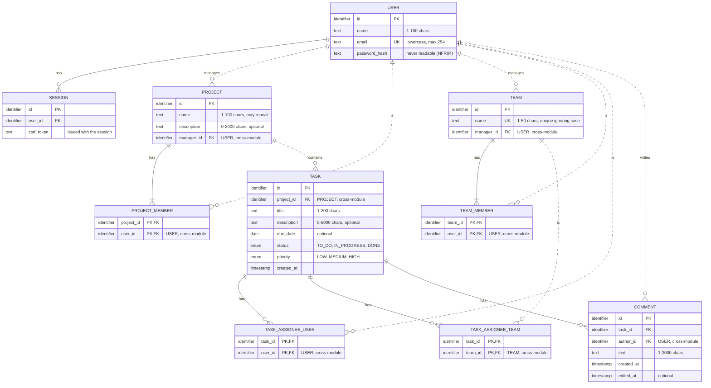

# Matriz — Data model (MVP)

Logical data model for the Matriz MVP. It covers the Must requirements in [requirements.md](requirements.md) and the user stories in [user-stories.md](user-stories.md), and follows the modular monolith in [ADR-0001](architecture/adr/ADR-0001-modular-monolith.md): one relational database, with each module owning its own data.

The model is technology-independent (C07). Types are generic: `identifier`, `text`, `date`, `timestamp`, `enum`.

## 1. ER diagram

Solid lines are references **within a module**. Dashed lines are references **between modules**: they're stored as identifiers, and whether the database also enforces them is still open (OP1).

## 2. Entities by module

| Module | Entities |
|---|---|
| **Accounts** | USER, SESSION |
| **Projects** | PROJECT, PROJECT_MEMBER |
| **Teams** | TEAM, TEAM_MEMBER |
| **Tasks** | TASK, TASK_ASSIGNEE_USER, TASK_ASSIGNEE_TEAM, COMMENT |

Each entity belongs to exactly one module. A module only reads and writes its own entities, and refers to other modules' entities by identifier (ADR-0001).

## 3. Entities

All text fields are stored without leading or trailing spaces, and length limits apply after trimming (D01, D02).

### USER (Accounts)

| Attribute | Type | Key | Constraints | Source |
|---|---|---|---|---|
| id | identifier | PK | Generated by the system. | — |
| name | text | | Required, 1–100 chars. | US19, US01 |
| email | text | UK | Required, max 254 chars, valid format, stored in lowercase, unique. | US19, US01, D03 |
| password_hash | text | | Required. Only a protected form of the password, never the password itself. | NFR04, US19 AC03, US01 AC10 |

### SESSION (Accounts)

| Attribute | Type | Key | Constraints | Source |
|---|---|---|---|---|
| id | identifier | PK | Unguessable. | US02 |
| user_id | identifier | FK → USER | Required. | US02 |
| csrf_token | text | | Required. Unguessable. Issued with the session; data-changing requests must send it (ADR-0002). | DoD06 |

Sessions are kept in the database, identified by a session cookie ([ADR-0002](architecture/adr/ADR-0002-session-cookie-authentication.md)). Log-out deletes the row.

### PROJECT (Projects)

| Attribute | Type | Key | Constraints | Source |
|---|---|---|---|---|
| id | identifier | PK | Generated by the system. | — |
| name | text | | Required, 1–100 chars. Not unique. | US03, D06 |
| description | text | | Optional, max 2000 chars. | US03 |
| manager_id | identifier | FK → USER (cross-module) | Required. Set at creation, never changes. | FR03, D07 |

### PROJECT_MEMBER (Projects)

| Attribute | Type | Key | Constraints | Source |
|---|---|---|---|---|
| project_id | identifier | PK, FK → PROJECT | Required. | US09 |
| user_id | identifier | PK, FK → USER (cross-module) | Required. | US09 |

The composite key makes each person a member of a project at most once (US09 AC05). The role is derived: a member is "Manager" if `user_id = PROJECT.manager_id`, otherwise "Member" (A3).

### TEAM (Teams)

| Attribute | Type | Key | Constraints | Source |
|---|---|---|---|---|
| id | identifier | PK | Generated by the system. | — |
| name | text | UK | Required, 1–50 chars, unique ignoring case. Stored as typed (after trimming). | US11, D06 |
| manager_id | identifier | FK → USER (cross-module) | Required. Set at creation, never changes. | FR08, D07 |

### TEAM_MEMBER (Teams)

| Attribute | Type | Key | Constraints | Source |
|---|---|---|---|---|
| team_id | identifier | PK, FK → TEAM | Required. | US12 |
| user_id | identifier | PK, FK → USER (cross-module) | Required. | US12 |

### TASK (Tasks)

| Attribute | Type | Key | Constraints | Source |
|---|---|---|---|---|
| id | identifier | PK | Generated by the system. | — |
| project_id | identifier | FK → PROJECT (cross-module) | Required. Never changes. | FR10 |
| title | text | | Required, 1–200 chars. Not unique. | US05, US05 AC09 |
| description | text | | Optional, max 5000 chars. | US05 |
| due_date | date | | Optional. Not earlier than the current day when set or changed (D12). | US05, US08 |
| status | enum | | Required: `TO_DO`, `IN_PROGRESS` or `DONE`. Starts as `TO_DO`. | FR13, US07 |
| priority | enum | | Required: `LOW`, `MEDIUM` or `HIGH`. `MEDIUM` if not given. | FR10, US05, US08 |
| created_at | timestamp | | Required. Set at creation, never changes. | US06 (ordering) |

### TASK_ASSIGNEE_USER (Tasks)

| Attribute | Type | Key | Constraints | Source |
|---|---|---|---|---|
| task_id | identifier | PK, FK → TASK | Required. | US10 |
| user_id | identifier | PK, FK → USER (cross-module) | Required. | US10 |

### TASK_ASSIGNEE_TEAM (Tasks)

| Attribute | Type | Key | Constraints | Source |
|---|---|---|---|---|
| task_id | identifier | PK, FK → TASK | Required. | US13 |
| team_id | identifier | PK, FK → TEAM (cross-module) | Required. | US13 |

A task has zero or more rows in each table. The composite keys make each person or team an assignee of a task at most once (US10 AC07, US13 AC09).

### COMMENT (Tasks)

| Attribute | Type | Key | Constraints | Source |
|---|---|---|---|---|
| id | identifier | PK | Generated by the system. | — |
| task_id | identifier | FK → TASK | Required. Never changes. | US21 |
| author_id | identifier | FK → USER (cross-module) | Required. Set at creation, never changes. | US21, US22 |
| text | text | | Required, 1–2000 chars. | US21, US22 |
| created_at | timestamp | | Required. Set at creation, never changes. | US21 (ordering, display) |
| edited_at | timestamp | | Optional. Set when the author edits the comment; when filled, the comment shows "(edited)". | US22 |

## 4. Business rules supported by the model

**Enforced by the model:** keys, required fields and value constraints.

| # | Rule | How | Source |
|---|---|---|---|
| R01 | An email belongs to at most one account, ignoring case. | USER.email unique, stored in lowercase. | FR01, D03, US01 AC02–AC03 |
| R02 | A person is a member of a project or team at most once. | Composite keys of PROJECT_MEMBER and TEAM_MEMBER. | US09 AC05, US12 AC04 |
| R03 | Team names are unique, ignoring case. | TEAM.name unique ignoring case. | D06, US11 AC03–AC04 |
| R04 | A task has zero or more assignees, people and teams, each at most once. | Composite keys of TASK_ASSIGNEE_USER and TASK_ASSIGNEE_TEAM. | FR14, US10 AC07, US13 AC09 |
| R05 | A task always has one of three statuses, starting as "To do". | TASK.status enum, default `TO_DO`. | FR10, FR13, US07 AC04 |
| R06 | Every task belongs to exactly one project. | TASK.project_id required. | FR10 |
| R07 | Every project and team has exactly one manager. | PROJECT.manager_id and TEAM.manager_id required. | FR03, FR08, D07 |
| R20 | A task always has a priority, "Medium" by default. | TASK.priority enum, default `MEDIUM`. | FR10, US05 AC02, AC10 |
| R21 | Every comment belongs to one task and has one author. | COMMENT.task_id and author_id required. | FR23 |

R20 and R21 were added in the [scope reconciliation](reviews/scope-reconciliation.md), after R08–R19, so they come after R07 here but keep their numbers. The numbers aren't changed because other documents refer to them.

**Enforced by the module's business logic:** these rules depend on other data or on the current date, so a single field constraint can't express them.

| # | Rule | Module | Source |
|---|---|---|---|
| R08 | The creator of a project or team also gets a member row, in the same transaction. | Projects, Teams | FR03, FR08, D07 |
| R09 | The manager's member row can't be deleted. | Projects, Teams | D07, US09 AC06, US12 AC05 |
| R10 | A person assignee must be a project member when assigned. | Tasks | US10 AC04–AC05 |
| R11 | A team assignee's members must all be project members when assigned. Not re-checked later. | Tasks | D09, US13 AC04, AC07 |
| R12 | When a member is removed from a project, their TASK_ASSIGNEE_USER rows in that project are deleted. Other assignees, including teams, stay. Their comments stay (D13). | Tasks (on the "member removed" event) | D10, D13, US09 AC03, US13 AC08, US21 AC06 |
| R13 | A new or changed due date can't be before the current day. | Tasks | D12, US05 AC04, US08 AC07 |
| R14 | Only project members can read or change a project and its tasks. | Projects, Tasks | NFR03, DoD03 |
| R15 | Text is trimmed and length limits are checked after trimming. | All | D01, D02 |
| R16 | Concurrent changes to the same task: the last saved one wins. | Tasks | D11 |
| R17 | Deleting a project deletes its PROJECT_MEMBER rows and, through the "project deleted" event, all its TASK rows with their assignee and COMMENT rows, in the same transaction. TEAM and TEAM_MEMBER rows are not affected. | Projects, Tasks (on the event) | FR05, US15 AC02, AC06 |
| R18 | Only the project manager can edit or delete a project, and only the team manager can rename or delete a team. | Projects, Teams | NFR03, US14 AC04, US15 AC04, US17 AC04, US18 AC04 |
| R19 | Deleting a team deletes its TEAM_MEMBER rows and, through the "team deleted" event, its TASK_ASSIGNEE_TEAM rows, in the same transaction. The tasks' other assignees stay. | Teams, Tasks (on the event) | FR20, US18 AC02 |
| R22 | Deleting a task deletes its assignee and COMMENT rows, in the same transaction. | Tasks | US16 |
| R23 | Only the author of a comment can edit or delete it. | Tasks | NFR03, US22 AC05 |
| R24 | The home dashboard counts each project's tasks per status, only for projects the user is a member of. | Projects, Tasks | FR07, US04 AC07 |

## 5. User story coverage

| US | Entities and attributes used |
|---|---|
| US19 | USER (seed rows, password_hash) |
| US02 | USER (email, password_hash, name), SESSION |
| DoD06 | SESSION.csrf_token |
| US03 | PROJECT, PROJECT_MEMBER (creator's row) |
| US04 | PROJECT_MEMBER, PROJECT (name, manager_id for the role), TASK (status, for the counts) |
| US05 | TASK |
| US06 | TASK (title, status, priority, due_date, created_at), TASK_ASSIGNEE_USER, TASK_ASSIGNEE_TEAM, USER.name, TEAM.name |
| US07 | TASK.status |
| US08 | TASK (title, description, due_date, priority) |
| US09 | PROJECT_MEMBER, USER.email, TASK_ASSIGNEE_USER (R12) |
| US10 | TASK_ASSIGNEE_USER, PROJECT_MEMBER |
| US11 | TEAM, TEAM_MEMBER (creator's row) |
| US12 | TEAM_MEMBER, USER.email |
| US13 | TASK_ASSIGNEE_TEAM, TEAM_MEMBER, PROJECT_MEMBER |
| US14 | PROJECT (name, description, manager_id) |
| US15 | PROJECT, PROJECT_MEMBER, TASK, COMMENT (R17) |
| US16 | TASK, TASK_ASSIGNEE_USER, TASK_ASSIGNEE_TEAM, COMMENT (R22) |
| US17 | TEAM (name) |
| US18 | TEAM, TEAM_MEMBER, TASK_ASSIGNEE_TEAM (R19) |
| US20 | TASK, TASK_ASSIGNEE_USER, TASK_ASSIGNEE_TEAM, COMMENT, USER.name, TEAM.name |
| US21 | COMMENT, USER.name |
| US22 | COMMENT (text, edited_at, author_id) |
| US23 | PROJECT.name, PROJECT_MEMBER |
| US24 | TASK (status, priority) |

US01 (optional extension) would use USER.

## 6. Assumptions and open points

### Assumptions to confirm

| # | Assumption | Impact if wrong |
|---|---|---|
| A1 | Identifiers are generated by the system and have no business meaning. | None on the structure. |
| A2 | Emails are stored in lowercase (D03), so uniqueness is a plain unique key. | If the original casing must be kept, an extra normalised email attribute is needed. |
| A3 | The member's role isn't stored: it's derived from `manager_id`. This differs from the wording "memberships (project, user, role)" in [04-solution-architecture.md](architecture/04-solution-architecture.md), and avoids two places that could disagree about who the manager is. | If roles become more than Manager/Member (e.g. transferring the manager role, F04), a role attribute in the member tables would be simpler. |
| A4 | Two assignee tables (people and teams), instead of one table with a "type" column. This lets each one refer to its own entity. | None for the MVP. |
| A5 | No `created_at` or `updated_at` on entities other than TASK and COMMENT, because no other MVP user story uses them. | Easy to add later (e.g. for F05, change history). |
| A6 | The dashboard counts (R24) are computed when read, not stored, so they can't disagree with the tasks. | With many tasks, stored counters might be needed (NFR06). |
| A7 | The demo accounts are ordinary USER rows inserted by the seed. No attribute marks them as demo accounts. | If demo accounts must behave differently (e.g. be reset), an attribute would be needed (PD12). |

### Open points (not decided here)

| # | Open point | Where it comes from |
|---|---|---|
| OP1 | **Cross-module references** (dashed lines): are they also protected by foreign keys in the database, or only stored as identifiers? This affects what happens when a referenced row is deleted. | 04-solution-architecture, section 7 |
| OP2 | **Session expiry:** where sessions are stored is decided (in the database, ADR-0002), but there is no expiry rule yet, so SESSION has no expiry attribute. Sessions last until log-out. | 04-solution-architecture, section 7, open point 2 |
| OP3 | **Assign and remove at the same time** (US10 AC05): R10 and R12 can conflict if they run in parallel. It may need a transaction isolation choice or a version attribute on TASK. | 04-solution-architecture, section 7 |
| OP4 | **Deleting data:** resolved. Deleting a project deletes its memberships and tasks (R17), deleting a team deletes its memberships and removes it from its tasks' assignees (R19), deleting a task deletes it with its assignees and comments (R22), and deleting a comment deletes only that comment (US22). Users are never deleted in the MVP (constraints.md, PD07). | requirements.md FR05, FR12, FR20 |
| OP5 | **Seed data:** how the demo USER rows are inserted and where their passwords come from (PD12). | constraints.md PD12 |
