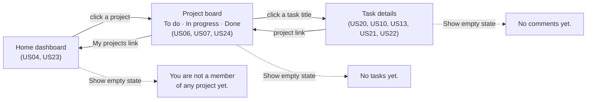

# Matriz — UI wireframe (MVP)

Low-fidelity wireframe of three connected screens of the Matriz MVP, the home dashboard, the project board and the task details, used to check that the navigation and the elements shown match the MVP features.

- **Published page:** https://claude.ai/artifact/SXbV7V1YMMJbqXWjFDjd4x. It is private, so share it from the page's Share menu before sending the link to anyone.
- **Copy in the repository:** [wireframe.html](wireframe.html). It is the same file that was published. Open it in a browser.

The wireframe was generated with an AI tool (Claude), from the user stories, their acceptance criteria and [openapi.yaml](../../openapi.yaml). The prompt is in [docs/prompts/ui-wireframe.md](../prompts/ui-wireframe.md). It was updated for the [scope reconciliation](../reviews/scope-reconciliation.md): task counts and search on the home dashboard, priority, several assignees and filters on the board, and a new task details screen with comments.

## How to use it

- **Point of view:** the screens are seen by Ana Silva, a demo account (US19). She manages *Website* and *Intranet*, and is a member of *App*.
- **Navigation:**
  - click a project on the **home dashboard** to open its board;
  - click a task title on the board to open its **details**;
  - use the links at the top (**My projects** / project name) to go back.
- **Show empty state:** switches the current screen between its version with data and its empty version (no projects, no tasks, or no comments). *Intranet* has no tasks, so it always opens in the empty state.
- **Story labels:** shows or hides the dark labels (US04, US05 …) that link each element to its user story. They are annotations, not part of the interface.
- **Search:** type in **Search projects** to narrow the list. The totals don't change (D14).
- **Board:** drag a card to another column, or use its ← → buttons, to change the task's status. Tick statuses and priorities to filter the board. The status can also be changed in the task's details.
- **Task details:** add or remove assignees (people and teams), change the priority, and add comments. Ana can edit and delete her own comments only.
- **Delete:** *Delete* on a project (manager only), a task or one of Ana's comments asks for confirmation on the page first, then removes it.
- **Forms:** *New project*, *New task* and the comment form work inside the wireframe. Submitting an empty name, title or comment, or a task title shorter than 3 characters, shows the exact error message from the user stories. The task form takes up to 150 characters in the title and 2000 in the description (US05, changed on 2026-11-11).

## Screens and navigation

### Screen 1 — Home dashboard

| Element | User story | Acceptance criteria |
|---|---|---|
| Project list (name, my role and task counts per status), sorted alphabetically | US04 | AC01, AC05, AC07 |
| Line "All my projects" with the totals per status | US04 | AC07, D14 |
| Click a project to open its board | US04 | AC02 |
| **Search projects** box; "No projects match your search." when nothing matches | US23 | AC01, AC02, AC04, AC05 |
| **New project** button and form (name, optional description) | US03 | AC01, AC02 |
| "Project name is required." on an empty name | US03 | AC03 |
| Empty state: "You are not a member of any project yet.", without the totals | US04 | AC03 |
| **Delete** on each project the user manages, with the confirmation `Delete "<name>" and all its tasks? This can't be undone.` | US15 | AC01–AC03 |
| User name and **Log out** in the header | US02 | AC02, AC10 (log-out isn't active in the wireframe) |

### Screen 2 — Project (board)

The project's tasks are shown as a **board** with one column per status: **To do**, **In progress** and **Done**.

| Element | User story | Acceptance criteria |
|---|---|---|
| **My projects** link (back to screen 1) | US04 | — (navigation) |
| Project name, role and description | US03, US04 | US03 AC01 |
| Three columns, one per status, each with its task count | US06, US07 | US06 AC01 |
| Cards newest first within each column | US06 | AC06 |
| Card: title, assignees ("Unassigned" when none), priority and due date ("No due date" when empty) | US06 | AC01 |
| Click a card's title to open the task details | US20 | AC01 |
| **Drag a card** to another column, or use its **← →** buttons, to change its status | US07 | AC01, AC02 |
| **Status** and **Priority** filters; only the chosen statuses' columns are shown; **Clear filters**; "No tasks match the filters." | US24 | AC01–AC04 |
| **New task** button and form (title, optional description and due date, priority "Medium" by default) | US05 | AC01, AC02 |
| "Task title is required." on an empty title | US05 | AC03 |
| A new task appears at the top of **To do**, as "Unassigned" | US05, US06 | US05 AC01 |
| Empty state: "No tasks yet.", with three empty columns | US06 | AC02 |
| **Delete project** in the header (manager only), with the same confirmation as on screen 1 | US15 | AC01–AC03 |
| **Delete** on each card, with the confirmation `Delete "<title>"? This can't be undone.` | US16 | AC01–AC03 |

### Screen 3 — Task details

| Element | User story | Acceptance criteria |
|---|---|---|
| Links back to **My projects** and to the project's board | US20 | — (navigation) |
| Title, description ("No description" when empty), status (changeable), priority and due date | US20, US07 | US20 AC01, AC04 |
| **Priority** selector | US08 | AC01 |
| **Assignees**: people and teams ("Design (team)"), each with × to remove it; a selector and **Assign** to add one | US10, US13 | US10 AC01–AC03, AC10; US13 AC01–AC03 |
| **Comments** from oldest to newest, with author, date and time, and "(edited)" | US21, US22 | US21 AC01, AC02; US22 AC01 |
| **Add a comment** form; "Comment is required." on an empty comment | US21 | AC01, AC03 |
| **Edit** and **Delete** only on Ana's own comments; delete asks `Delete this comment? This can't be undone.` | US22 | AC01–AC04 |
| Empty state: "No comments yet." | US21 | AC07 |
| **Delete task**, with the same confirmation as on the board | US16 | AC01–AC03 |

**US06 updated for the board.** US06 describes the board: one column per status, newest first within each column. The client groups the tasks from `GET /projects/{projectId}/tasks` by status, and sends the filters as query parameters (US24).

## Out of the wireframe

- **Other MVP screens:** log-in (US02), project members (US09), teams (US11, US12, US17, US18), editing a task's title, description and due date (US08) and editing a project (US14). They have no screen here, because the scope was these three screens. The browser application builds them with the same patterns (see below).
- **Server checks:** the wireframe doesn't run validations that depend on the server, such as membership rules (US10 AC04, US13 AC04), due dates in the past (US05 AC04) and the author check on comments (US22 AC05).
- **Optional extensions:** sign-up (US01) and password recovery (F08) are not in the MVP.
- **Excluded features:** charts and reports, excluded by C02. The dashboard shows plain counts only.

## Visual system of the browser application

The browser application follows the wireframe's screens and navigation, with a visual system of its own instead of the wireframe's greyscale. It was made for the [front-end prompt](../prompts/frontend.md), with the user's approval on 2026-11-11.

- **Inspiration:** the visual language of 1980s personal-computer print advertising (the user's reference: a collection of Apple's ads of the 1970s and 1980s). Large, tightly set serif headlines in sentence case; small serif body copy; warm paper and ink; the platinum beige of the machines; six saturated colours used only as small accents; lots of white space. Nothing is copied from the ads, and no Apple name, logo, apple shape or six-colour stripe is used.
- **Fonts**, served with the application (no external requests, PRI02), SIL Open Font License: **EB Garamond** for headings, names and empty states; **IBM Plex Sans** for the interface; **IBM Plex Mono** for counts. Files and licences in `frontend/src/assets/fonts/`.
- **Colours:** paper `#f3eee3`, surface `#fbf8f1`, ink `#1d1b18`, muted `#5c574e` and platinum `#e4dccb`, with a dark mode in ink and paper. Light is the default whatever the system's setting; a **Dark mode / Light mode** button in the header and on the log-in screen switches, and the browser remembers the choice. The six accents carry meaning: blue, orange and green for To do, In progress and Done; red, ochre and purple for High, Medium and Low. Every text colour meets WCAG AA (4.5 : 1) in both modes; the ratios are noted in `frontend/src/styles/tokens.css`, where every token is defined once.
- **Logo:** original. Three equal, rounded strokes at 45 degrees, rising from left to right like "///", in the status colours: blue (To do), orange (In progress) and green (Done). Next to it, the word "matriz" in EB Garamond. It is also the favicon. (Chosen by the user on 2026-11-12, after several rounds: a grid of squares, a "#", a slanted grid, a lattice, a gem and cubes.)
- **Components:** page shell (logo, *My projects*, *Teams*, the user and *Log out*), breadcrumbs, buttons, labelled fields, panels, tables, pills (role, status, priority), the confirmation box and the loading, empty and error states, in `frontend/src/styles/components.css` and `frontend/src/ui.tsx`.

| Screen | Address | Stories |
|---|---|---|
| Log-in | (no session) | US02, US19 |
| My projects (home dashboard) | `#` | US03, US04, US15, US23 |
| Project: **Board** tab | `#/projects/<id>` | US05–US07, US14–US16, US24 |
| Project: **Members** tab | `#/projects/<id>/members` | US09 |
| Task details, with assignees and comments | `#/projects/<id>/tasks/<id>` | US07, US08, US10, US13, US16, US20–US22 |
| Teams | `#/teams` | US11–US13, US17, US18 |
