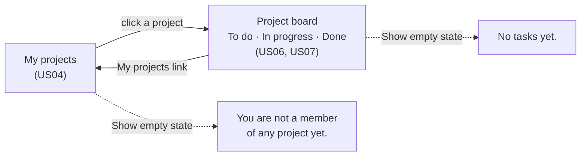

# Matriz — UI wireframe (MVP)

Low-fidelity wireframe of two connected screens of the Matriz MVP, the project list and the project board, used to check that the navigation and the elements shown match the MVP features.

- **Published page:** https://claude.ai/artifact/SXbV7V1YMMJbqXWjFDjd4x. It is private, so share it from the page's Share menu before sending the link to anyone.
- **Copy in the repository:** [wireframe.html](wireframe.html). It is the same file that was published. Open it in a browser.

The wireframe was generated with an AI tool (Claude), from the user stories, their acceptance criteria and [openapi.yaml](../../openapi.yaml). The prompt is in [docs/prompts/ui-wireframe.md](../prompts/ui-wireframe.md).

## How to use it

- **Point of view:** the screens are seen by Ana Silva. She manages *Website* and *Intranet*, and is a member of *App*.
- **Navigation:**
  - click a project on **My projects** to open it;
  - use the **My projects** link at the top of the project screen to go back.
- **Show empty state:** switches the current screen between its version with data and its empty version. *Intranet* has no tasks, so it always opens in the empty state.
- **Story labels:** shows or hides the dark labels (US04, US05 …) that link each element to its user story. They are annotations, not part of the interface.
- **Board:** drag a card to another column, or use its ← → buttons, to change the task's status. Change the assignee with the selector on the card.
- **Delete:** *Delete* on a project (manager only) or on a task card asks for confirmation on the page first, then removes it.
- **Forms:** *New project* and *New task* work inside the wireframe. Submitting an empty name or title shows the exact error message from the user stories.

## Screens and navigation

### Screen 1 — My projects

| Element | User story | Acceptance criteria |
|---|---|---|
| Project list (name and my role), sorted alphabetically | US04 | AC01, AC05 |
| Click a project to open it | US04 | AC02 |
| "Manager" / "Member" role | US04 | AC01 |
| **New project** button and form (name, optional description) | US03 | AC01, AC02 |
| "Project name is required." on an empty name | US03 | AC03 |
| Empty state: "You are not a member of any project yet." | US04 | AC03 |
| **Delete** on each project the user manages, with the confirmation `Delete "<name>" and all its tasks? This can't be undone.` | US15 | AC01–AC03 |
| User name and **Log out** in the header | US02 | AC02 (log-out isn't active in the wireframe) |

### Screen 2 — Project (board)

The project's tasks are shown as a **board** with one column per status: **To do**, **In progress** and **Done**.

| Element | User story | Acceptance criteria |
|---|---|---|
| **My projects** link (back to screen 1) | US04 | — (navigation) |
| Project name, role and description | US03, US04 | US03 AC01 |
| Three columns, one per status, each with its task count | US06, US07 | US06 AC01 (every task, including done ones) |
| Cards newest first within each column | US06 | AC06 |
| Card: title, assignee and due date ("No due date" when empty) | US06 | AC01 |
| **Drag a card** to another column to change its status | US07 | AC01, AC02 (any transition, including backwards) |
| **← →** buttons on each card: the same move, with a mouse click or the keyboard | US07 | AC01, AC02 |
| **Assignee** selector on each card: Unassigned, people, teams ("Design (team)") | US10, US13 | US10 AC01–AC03, US13 AC01–AC03 |
| **New task** button and form (title, optional description and due date) | US05 | AC01, AC02 |
| "Task title is required." on an empty title | US05 | AC03 |
| A new task appears at the top of **To do**, as "Unassigned" | US05, US06 | US05 AC01 |
| Empty state: "No tasks yet.", with three empty columns | US06 | AC02 |
| **Delete project** in the header (manager only), with the same confirmation as on screen 1 | US15 | AC01–AC03 |
| **Delete** on each card, with the confirmation `Delete "<title>"? This can't be undone.` | US16 | AC01–AC03 |

**US06 updated for the board.** US06 now describes the board: one column per status, newest first within each column (AC01 changed, AC06 added). The API stays as it is: the client groups the tasks from `GET /projects/{projectId}/tasks` by status.

## Out of the wireframe

- **Other MVP screens:** log-in and sign-up (US01, US02), project members (US09), teams (US11, US12, US17, US18), editing a task (US08) and editing a project (US14). They have no screen here, because the scope was these two screens.
- **Server checks:** the wireframe doesn't run validations that depend on the server, such as membership rules (US10 AC04, US13 AC04) and due dates in the past (US05 AC04).
- **Excluded features:** charts, metrics and filters. Charts and metrics are excluded by C02. Filters are FR17, a Should requirement.
